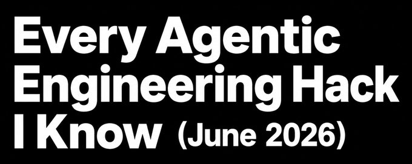

# 我知道的所有 Agentic Engineering 技巧（2026年6月）

**作者**: Matt Van Horn (@mvanhorn)



三个月前我发布了《我知道的所有 Claude Code 技巧》，获得了91.3万次浏览。@kevinrose 问我用什么 IDE，我的回答是："不用 IDE，只用 plan.md 文件和语音。"

这以前被称为 vibe coding（氛围编码）。去年感恩节前后，模型变得足够强大，玩具变成了现实，也就是现在人们所说的 Agentic Engineering。这是我能做出东西的唯一原因。今年我推出了 last30days（2.7万星）、Printing Press（4000+星）和刚发布的 Agent Cookie，并成为了一些最大的开源项目的顶级贡献者：Python、Go、GStack 和 Paperclip。自从高中以来，我从未做出过有人重视的软件。以下是我的技巧。

**YOLO TL;DR 技巧**：把整篇文章粘贴给你的智能体，让它制定一个计划来设置里面的所有内容，然后一次一个技巧地执行这个计划。这就是我的整个工作栈，无需阅读。

---

## 1. 有想法的那一刻，创建 CE plan.md

仍然是第一条规则。仍然是我学到的最重要的东西。

我一有想法，就用 `/ce-plan` 创建 plan.md。不是"让我想想"，不是"让我开始编码"。每次都是 `/ce-plan`。它还能接收图片，所以任何你能捕捉到的东西都是起点：

- 疯狂的产品想法：`/ce-plan`。
- GitHub 上的 Bug：复制 issue URL，粘贴，`/ce-plan`。
- 终端错误：Cmd+Shift+4 截图，Ctrl+V 粘贴，`/ce-plan fix this`。
- 截图、错误信息、设计原型、Slack 线程：都可以丢进去。

当想法还很模糊，我甚至不知道自己想要什么时，我先用 `/ce-brainstorm` 和智能体一起思考，等想法清晰后再用 `/ce-plan`。

在底层，`/ce-plan` 会并行启动多个研究智能体。一个读取你的代码库，找到模式，检查你的约定。一个搜索你过去的解决方案以获取经验。如果主题需要，更多的智能体会研究外部文档和最佳实践。所有这些同时进行。然后它整合并编写结构化的 plan.md：问题是什么、方法是什么、要修改哪些文件、带复选框的验收标准、要遵循的代码模式。基于你的仓库、你的约定、你的历史。不是通用建议。

`/ce-work` 执行这个计划并构建。上下文崩溃了？启动新会话，指向计划，从上次中断的地方继续。计划是在任何情况下都能幸存的检查点。

传统开发是 80% 编码，20% 规划。这正好相反。思考放在计划里。执行是机械的。

[Compound Engineering](https://github.com/EveryInc/compound-engineering-plugin)，来自 @kieranklaassen 和 @trevin，是实现这一切的插件。

我成了超级粉丝，然后是贡献者，现在我是核心团队之后的第三大贡献者。我的规则是：除非确实是单行更改，否则总是先写 plan.md。

**技巧**：
- 安装 Compound Engineering：`/plugin marketplace add EveryInc/compound-engineering-plugin`
- 粘贴截图、Bug URL 或错误，然后 `/ce-plan`，然后 `/ce-work`。
- 想法模糊？先 `/ce-brainstorm`。

---

## 2. 不要阅读 plan.md

我总是创建 plan.md，但几乎从不阅读它。计划是给智能体看的，不是给你这个愚蠢的人类看的。

强制计划存在可以防止智能体偷懒。它迫使智能体进行研究、承诺一种方法、写下验收标准，然后实际达到这些标准。有计划的编码智能体会完成工作。没有计划的智能体会偷工减料并提前停止。计划是缰绳。

所以我让它写计划，我浏览标题，然后运行 `/ce-work`。如果有问题，我就在会话中直接问："等等，为什么用这种方法？"或者我要一个 TLDR。或者，当我不理解时，"用简单的方式解释这个计划"。我得到一段版本，点头，继续。我不会坐在那里读 300 行 markdown。那是智能体的作业，不是我的。

制定计划。信任计划。不要阅读计划。

**技巧**：
- 不要让自己阅读计划。直接问：TLDR？用简单方式解释这个计划？或者"等等，为什么用这种方法？"

---

## 3. 将 /ce-plan 用于最深层的非工程工作，为计划制定计划

人们认为 `/ce-plan` 和 `/ce-work` 只用于代码。自三月以来我学到的最大的一点是它们不是。我现在做的最深层的知识工作都通过同样的循环，关键是让第一个计划成为计划的计划。这也不是我在强迫代码工具做它不该做的事情：`/ce-plan` 内置了通用规划模式，专门为这种非代码工作设计。

不仅仅是商业问题。战略文档、产品规格、竞争分析、董事会更新，都可以用同样的循环。

举个真实的例子。我与前 GV 研究合伙人 Michael Margolis（以靶心客户方法闻名）会面，讨论我正在酝酿的一个商业挑战。他让我读他的书，可以在他的网站上免费下载 PDF。过去我会浏览一下就完事。相反，我打开 Claude Code 说，大概是：

"/ce-plan make a plan for the plan. 我即将交给你两件事：Margolis 的书作为 PDF，以及我刚和他开的两小时 Granola 会议记录，其中包含了我们讨论的全部背景。我想要一个深思熟虑的计划，说明我的商业问题、那次对话以及书中的教训如何结合成我可以实际使用的东西。现在不要写那个文档。写文档是工作。现在我只想要一个计划，说明你将如何阅读这本书、挖掘会议记录，并产出一份出色的文档。"

它花了接下来的45分钟创建了一个史诗般的计划。

这也是我知道的让 LLM 不偷懒的最好技巧。直接要求交付成果，它会偷工减料。先要求它计划如何产出交付成果，然后执行该计划，它每次都会做深入版本。

**技巧**：
- 深层非代码工作：`/ce-plan make a plan for the plan`，交给它你所有的上下文和记录，然后 `/ce-work`。

---

## 4. 使用语音输入

语音到 LLM 与语音到任何其他东西都不同。转录不必完美，因为听众理解上下文。它会猜测麦克风听错的内容。你可以含糊不清、拖拖拉拉、重新开始一句话。语音终于能用了，因为另一端的东西足够聪明，可以填补空白。

**我的设置**：
- **Mac**：[Monologue](https://monologue.to/)（来自 Every）或 [Wispr Flow](https://wisprflow.ai/)。选一个，将语音输入到任何聚焦的应用程序中，对着 Claude Code 说话。我在办公室买了一个鹅颈麦克风。
- **手机**：跳过 Monologue 和 Wispr Flow，在 iOS 上切换它们太烦人了。Apple 内置的听写功能就足够了，因为你是在和 LLM 说话，而不是人。它可以弄乱一半的单词，智能体仍然能理解。随意的笔记就可以。

老实说：我一个人的时候语音用得很好。在办公室里我很挣扎。人们说你可以对着麦克风耳语，但我发现我实际上不会这么做，因为我不想粗鲁或打扰周围的人。所以共享房间里的办公桌仍然是我整个工作流程的弱点。如果你在开放式办公室里解决了语音问题而不成为那种人，请告诉我怎么做。我真的想要建议。

**技巧**：
- Mac：安装 [Monologue](https://monologue.to/) 或 [Wispr Flow](https://wisprflow.ai/)。手机：使用 Apple 听写。买一个 [鹅颈麦克风](https://www.amazon.com/dp/B0BF969RVP)。

---

## 5. cmux 中的大量标签页

这就是我一天的实际工作方式。四到六个 [cmux](https://cmux.com/) 标签页，有时更多，每个都是单独的会话：

- 一个写计划。
- 一个从不同的计划构建。
- 一个运行 last30days。
- 一个修复我在测试上一个东西时发现的 Bug。

当 `/ce-plan` 在一个窗口启动研究时，我切换到另一个窗口并 `/ce-work` 已经写好的计划。当那个在构建时，第三个窗口收到新粘贴的 Bug。当我循环回来时，第一个已经完成并在等待。

我听说 [Orca](https://onorca.dev/) 在移动工作方面做得很好。我以前也是 [Ghostty](https://ghostty.org/) 的纯粹主义者，但我在 ghostty 中丢失了太多通知。

**技巧**：
- 使用 [cmux](https://cmux.com/)。
- 保持 4 到 6 个标签页打开，每个放不同的任务。

---

## 6. 将终端默认设置为 Claude 或 Codex，而不是 Shell

新标签页应该直接打开到 Claude Code，而不是 Shell。打开标签页，你已经在和智能体说话了。不用 cd，不用输入 claude。当新会话只需一次按键时，你会启动更多会话。我也不用文件夹。你的智能体可以找到你的项目。

**技巧**：
- 粘贴给你的智能体："让每个新终端标签页直接打开到 Claude Code。在 ~/.config/ghostty/config 中，添加行 `command = ~/.local/bin/claude-launcher.sh`，不要干扰该文件中已有的任何其他设置。然后创建 `~/.local/bin/claude-launcher.sh`，运行 `claude --dangerously-skip-permissions`，当 Claude 退出时打印一条简短消息并让我进入交互式登录 zsh。给脚本 chmod +x。这对 Ghostty 和 cmux 都有效，因为 cmux 读取相同的 Ghostty 配置。"

---

## 7. 远程控制每个窗口，并给 Claude Code 或 Codex 一个电子邮件地址

两个技巧让每个会话从任何地方都能访问。

**每次打开新窗口时开启远程控制**

设置远程控制为每个会话自动开启。

现在每个窗口都可以从 Claude 移动应用访问。在办公桌前开始会话，走开，在手机上继续完全相同的实时运行。在某个地方，你正在操控家里 Mac 上正在运行的东西。

**给你的 Claude 一个电子邮件地址**

Claude Code 可以通过 AgentMail 拥有电子邮件地址。创始人 Adi @adisingh 教我的。发送邮件到收件箱，一个新会话会打开并开始处理主题和正文中的任何内容，附件可以通过路径访问。晚餐时发现 Bug？从手机发邮件，在你回到屏幕前会话已经在运行了。我把整个项目开源了：[github.com/mvanhorn/agentmail-to-claude-code](https://github.com/mvanhorn/agentmail-to-claude-code)。

三个部分：
- 一个守护进程，通过 WebSocket 监视 AgentMail 收件箱。对于每个白名单上的邮件，它打开一个新的 Claude 会话，将邮件写入提示文件，并告诉 Claude 读取并处理。
- 两个终端后端，cmux 或独立的 Ghostty，所以它可以驱动你已经启动的任何东西。
- 一个发送器。我把它连接到 Hermes 中的 cc 命令，所以从我的手机运行 `cc <task>`，它就会作为工作会话落在我的 Mac 上，不需要 VPN，不需要 SSH。

白名单是网关。只有你控制的地址才能通过，任何 DKIM 或 SPF 失败的邮件在会话打开之前就会被丢弃。

**技巧**：
- 始终开启远程控制：在 `~/.claude/settings.json` 中添加 `"remoteControlAtStartup": true`。
- 给 Claude 一个邮箱。粘贴给你的智能体："使用 github.com/mvanhorn/agentmail-to-claude-code 给 Claude Code 一个电子邮件地址。克隆它，设置一个 AgentMail 收件箱，在 cc.env 中填写我的 API 密钥、收件箱、只包含我自己地址的白名单，以及我的终端（cmux 或 Ghostty），然后运行守护进程并将其安装为 launchd 作业。当我发送邮件到该收件箱时，一个新的 Claude Code 会话应该在这台 Mac 上打开并开始处理主题和正文。"

---

## 8. 危险地跳过权限，我是认真的

Claude Code 每次编辑和命令都会询问权限。有六个会话时你无法照看它。两个设置让它变得可行。人们说自动模式是"更安全"的方式，但它让我太慢了。

`skipDangerousModePermissionPrompt: true` 是关键。没有它，Claude 会要求你确认每个会话。你也可以 Shift+Tab 切换。人们告诉我新的"自动"模式在更安全的情况下能达到大部分效果。也许吧。我说 YOLO。这是我的电脑。如果我搞砸了一切，GitHub 还在那里。当我设置朋友的 Claude Code 时，AI 积极地试图说服他不要启用这个。你必须直接告诉它。

另一个设置是声音钩子，有六个会话时必不可少。

走开，听到声音再回来。有六个会话运行时，声音是你知道哪个刚完成的方式。

**技巧**：
- 粘贴到 `~/.claude/settings.json`：
```json
{ "permissions": { "allow": [ "WebSearch", "WebFetch", "Bash", "Read", "Write", "Edit", "Glob", "Grep", "Task", "TodoWrite" ], "deny": [], "defaultMode": "bypassPermissions" }, "skipDangerousModePermissionPrompt": true }
{ "hooks": { "Stop": [ { "hooks": [ { "type": "command", "command": "afplay /System/Library/Sounds/Blow.aiff" } ] } ] } }
```
- Codex 有相同的 YOLO 模式。在 `~/.codex/config.toml` 中：
```toml
approval_policy = "never"
sandbox_mode = "danger-full-access"
```
或者用 `codex --yolo` 启动一次性会话。

---

## 9. 如何通过 Codex 运行大部分代码而无需打开 Codex CLI

我整天都在向 Codex 发送工作，但几乎从不打开 Codex CLI 来做。Claude 计划，Codex 构建，我从不离开我的 Claude 会话。

三种无需离开 Claude 即可向 Codex 提交工作的方式：
- Codex IDE 扩展：发送任务，应用结果，从不进入 Codex 终端。
- `/ce-work --codex`：从 Compound Engineering 循环内部直接将构建委托给 Codex。
- Printing Press Codex 模式：在打印新 CLI 时在提示末尾加上 `codex`，它会将构建交给 Codex。

我的设置，两个引擎都调到超高推理：
- **Codex**：推理 xhigh，快速模式开启，始终。
- **Claude Code**：推理 xhigh，快速模式关闭。它的快速模式在你 200 美元的 Max 计划之上按 token 计费，所以我跳过它。

两个 200 美元的计划并排运行是一整个第二引擎。我将大型并行构建推送到 Codex，让 Claude 专注于规划和品味。有些朋友反过来运行，Codex 构建，Claude 审查。

**技巧**：
- Codex：推理 xhigh，快速模式开启。Claude Code：xhigh，快速模式关闭。
- 向 Codex 提交工作：Codex IDE 扩展、`/ce-work --codex`，或在 Printing Press 提示末尾加上 `codex`。

---

## 10. 规划前先研究：last30days

在 `/ce-plan` 之前，我通常先运行 `/last30days`。

我曾在 Vercel 的 agent-browser 和 Playwright 之间选择。没有阅读文档，我运行了 `/last30days Vercel agent browser vs Playwright`。几分钟内：几十个 Reddit 帖子、X 帖子、YouTube 视频、HN 故事。Agent-browser 每次调用使用的上下文少得多，Playwright 仅工具定义就会丢弃数千个 token。我将整个输出输入到 `/ce-plan integrate agent-browser`。计划基于社区现在实际知道的内容，而不是六个月前的训练数据。

last30days 是开源的，现在超过 2.6 万星。它并行搜索 Reddit、X、YouTube、TikTok、Instagram、HN、Polymarket、GitHub 和网络。我在选择库之前、构建功能之前、与商业伙伴会面之前、写文章之前运行它。研究、计划、构建。这才是真正的循环。

**技巧**：
- 安装 last30days。在 `/ce-plan` 之前，运行 `/last30days <topic>`。
- 确保安装 ScrapeCreators 密钥。

---

## 11. 所有内容都用 Granola，并将原始记录放入你的 LLM

我和一位候选人共进午餐。我们聊了产品、食物和孩子，九十分钟的正常对话中穿插着一个产品想法。Granola 在运行。之后，我将完整的原始记录粘贴到 Claude Code：`/ce-plan turn this into a product proposal`。

关键是原始。我不先总结。我把整个凌乱的记录丢进去，包括关于寿司的题外话，让 Claude 根据我的实际代码库和我写过的每个先前战略计划进行提取。Granola 上下文加上代码库加上先前计划等于黄金。它一次性生成了一个提案，忽略了餐厅谈话，我当晚就发送了。那个人现在全职和我们一起工作。

自三月以来的升级：Printing Press Granola CLI。太神奇了。我将任何会议作为干净的结构化数据直接拉取到会话中，搜索我曾经参加过的每一次会议，找到三周前某人说的一件事，并将其输入到计划中。不再需要复制粘贴。每次会议的上下文都只需一个命令。

**技巧**：
- 将原始 Granola 记录放入 `/ce-plan`，不要先总结。
- 安装 Printing Press Granola CLI。

---

## 12. 人类信号

这是我花了最长时间才转变的心态。当你运行六个智能体时，你的工作不是做工作。你的工作是成为信号。

智能体提供数量。你提供品味、方向和反应重定向循环。你看看返回的内容，说"选项二更接近但使用选项一的语言"、"解决最大的风险"、"这段太长了"，然后它们就会移动。循环中稀有且有价值的东西是你的判断力，而不是你的打字能力。我越是专注于成为人类信号而不再试图同时成为一只手来做工作，我做出的东西就越多。

做品味。让它们做手。

**技巧**：
- 通过用你的大脑指导你的智能体来为世界增加价值。它仍然有价值。

---

## 13. HyperFrames 用于视频，用于所有事物

视频曾经是我外包或跳过的东西。现在我用同样的方式制作视频：我说，智能体构建，我反应。

HyperFrames 让我将视频构建为 HTML，所以智能体可以编写它。循环与代码完全相同，输出只是 MP4 而不是 PR。每个视频都是一个文件夹，包含 script.md，逐场景、动态排版、字幕承载每个节拍。智能体将该脚本转换为合成并渲染。无需编辑器，无需时间线。

我这样制作的发布视频：
- Granola CLI 演示
- Agent Cookie 发布
- Agent Cookie Launch Video Made in HyperFrame

视频的成本降到了一次对话，所以任何值得拥有视频的东西现在都可以得到：发布视频、产品演示、动画解说、带字幕的片段。它们不仅发布在 X 上：我会将渲染的演示直接放入 PR，就像 atlas-lean（Facebook 的 AI 研究项目）上的这个一样。

**技巧**：
- 在 HyperFrames 中构建视频：编写 script.md，让你的智能体渲染成 MP4。
- 将 GIF 上传到 catbox，它们在 GitHub 上的 PR、README 和 issues 中渲染效果很好。

---

## 14. 你的笔记是智能体的知识库

三月的策略文件夹技巧得到了推广。计划每次都变得更好的原因是 Claude 可以访问我写过的每个先前计划。复合上下文。所以我把它指向了我的整个大脑。

我指向的工具：
- **Bear**，使用 Bear CLI。十年的笔记、会议、半成品想法和决策，智能体可以读写。个人 RAG，不用这么称呼它。我放的越多，每个会话就越聪明。
- **Obsidian**。我不用，但人们喜欢它，插件生态系统很深。
- **gbrain**。我的大脑在机器和智能体之间同步。
- **supermemory**。很多人发誓的智能体记忆层。现在正在研究， verdict 即将出炉。

技巧的关键在于：选择一个有 CLI 或 API 的笔记工具，让你的智能体指向它，让你自己的知识复合增长。

**技巧**：
- 让你的智能体指向两者：你用来写笔记的工具（Bear、Obsidian）和为你记忆的智能体大脑（gbrain、supermemory）。选择有 CLI 或 API 的，这样它可以读取。

---

## 15. 随时随地工作 - 我的 Mac mini

**技巧**：
- **Mosh**，当你必须 SSH 时。它让会话感觉像本地的，在糟糕的 wifi 和漫游时响应迅速。在普通 SSH 上，Claude Code 爬行，每个按键都在等待往返。远程机器上可用和痛苦之间的区别。
- **Tmux**，用于飞机。在 tmux 会话中 SSH 到远程机器，工作在那里运行，而不是在你的笔记本电脑上。大西洋上空 wifi 中断二十分钟，你重新连接，附加，它就在你离开的地方。我从欧洲回家的整个航班都在发布功能。
- **Hermes 和 OpenClaw**，都在运行，用于自主远程工作。Hermes 用于自我学习生态系统，在重复任务上变得更好，OpenClaw 用于智能体构建的技能广度。我在两者之间切换。如果你早期放弃了 OpenClaw，删除它并重新开始。
- **Agent Cookie** 用于在你的 Mac mini 和主 Mac 之间同步 cookies 和 .env 文件。

---

## 16. Proof：用于向同事发送计划

plan.md 对我来说很完美，但交给不生活在终端里的人就没用了。这是最后一个真正的差距，Proof（也来自 Every）填补了它。

在 Proof 中打开计划像文档一样阅读很不错。但它变得必不可少的地方是向同事发送计划。我把 plan.md 或规范拖放到 Proof 中，发送链接，非终端用户可以清晰地阅读，内联评论，并跟踪进度，无需打开 CLI。

**技巧**：
- 安装 Proof。将 plan.md 文件拖放到其中，向同事发送链接。

---

## 原始来源

https://x.com/mvanhorn/status/2061877533885473181
