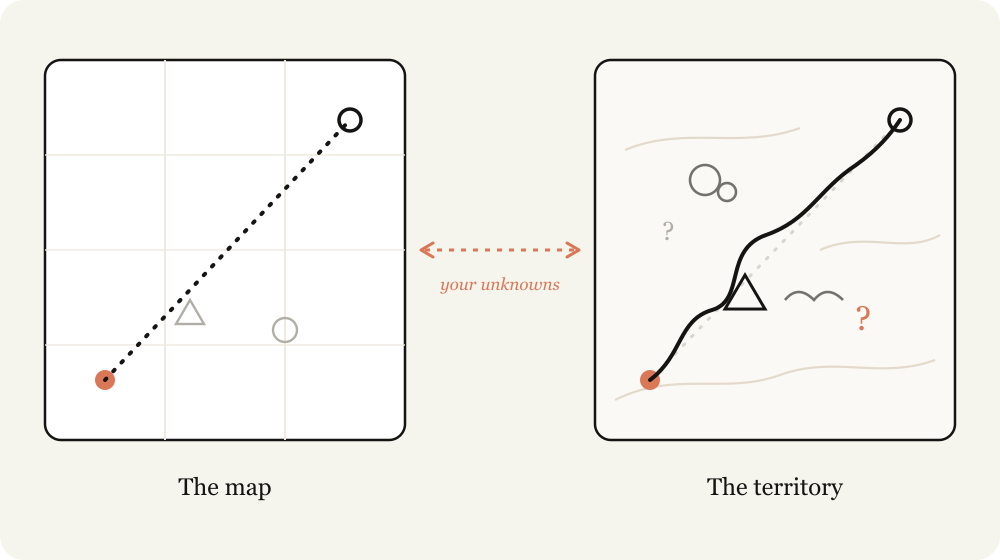
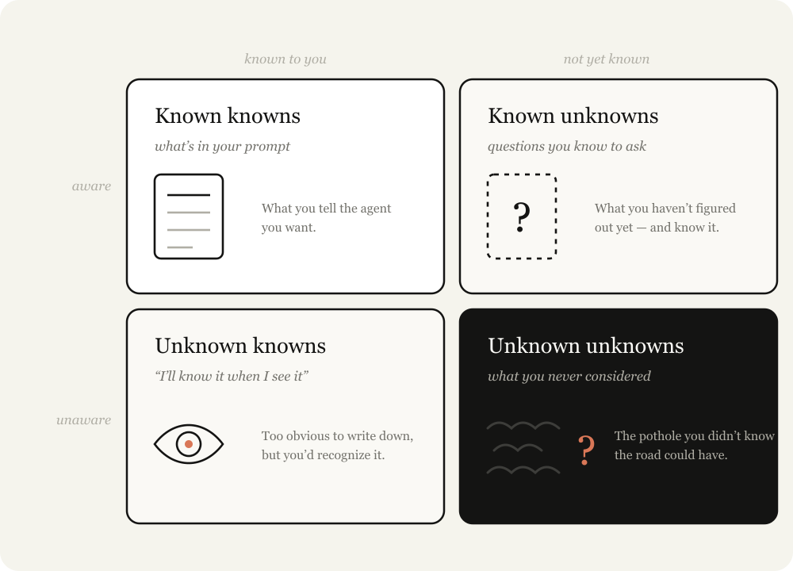
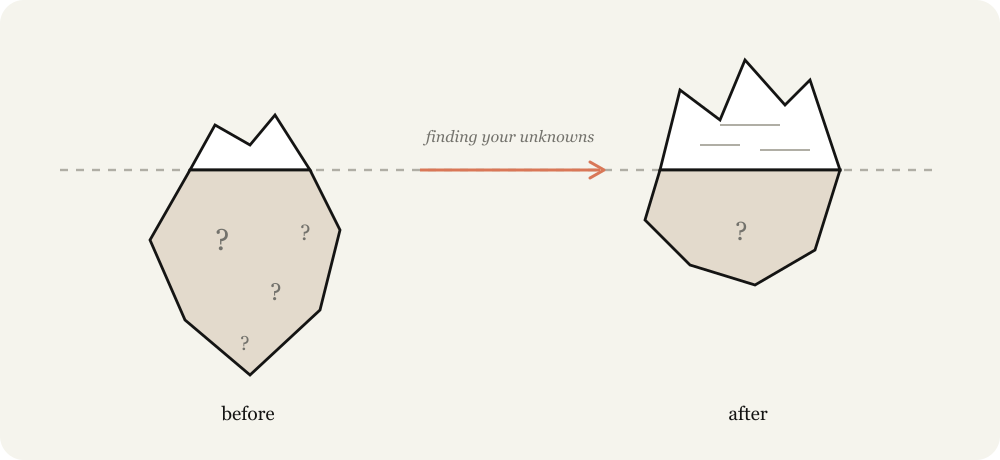

# Claude Fable 5 实战指南：发现你的未知

- **分类：** [Claude Code](https://claude.com/blog/category/claude-code)
- **产品：** Claude Code
- **日期：** 2026年7月6日
- **阅读时间：** 5 分钟

---

使用 Claude Code 时，我经常想起"地图"与"实地"之间的区别。

地图，是对即将完成的工作的抽象表达，是我的提示词、技能和上下文——这是我交给 Claude 的东西。而实地，是工作真正需要发生的地方——代码库、真实世界、它的实际约束。

"地图"与"实地"之间的差距，就是我所说的*未知（unknowns）*。当 Claude 遇到未知时，它必须基于对我意图的最佳猜测来做决策。工作量越大，Claude 可能遇到的未知就越多。

Claude Fable 是我遇到的第一个模型——我发现工作质量的瓶颈，已经变成了**我能否澄清它的未知**。

重要的是，仅仅提前规划并不总是够的。未知可能深藏在实现细节中，或者你的未知可能指向一个事实：你也许应该用完全不同的方式来解决这个问题。

我发现，与 Fable 合作是一个迭代过程——在实现之前、实现之中、实现之后，持续发现我的未知。

## 认识你的未知

什么是你的未知？当我带着问题找 Claude 时，我通常将其分为四类：

- **已知的已知（Known Knowns）：** 这基本上就是我在提示词中写的内容。我告诉 Agent 我想要什么？
- **已知的未知（Known Unknowns）：** 我还没搞清楚，但我意识到自己还没搞清楚的，是什么？
- **未知的已知（Unknown Knowns）：** 什么是我觉得太理所当然、永远不会写下来，但看到后能认出来的？
- **未知的未知（Unknown Unknowns）：** 我完全没考虑过的是什么？我不知道自己欠缺哪些知识？我知道某件事能做到多好吗？

最优秀的 Agent 编码者，拥有的未知相对较少。看 [Boris](https://www.linkedin.com/in/bcherny) 或 [Jarred](https://www.linkedin.com/in/jarred-sumner-a8772425) 这样的人写提示词，很明显他们在细节上知道自己想要什么。他们与代码库和模型行为都深度同步。

但他们也会为未知留出余地。从很多方面来说，减少和规划你的未知，就是 Agent 编码的**核心技能**。但幸运的是，通过与 Claude 合作，这个技能是可以提升的。

## 帮 Claude 更好地帮你

指导 Claude 是一种微妙的平衡。如果你过于具体，Claude 会严格遵循你的指令，即使转向可能更合适。如果你过于模糊，Claude 往往会基于行业最佳实践做出选择和假设，但这些可能不适合你的任务。

当你不考虑自己的未知时，你会在两方面都失败。你不知道什么时候路上会充满障碍，也不知道什么时候路是畅通的、但你仍然希望 Claude 改变方向。

Claude 可以帮你更快地发现未知。它能极快地搜索你的代码库和互联网，而且对大多数话题的了解比你多得多。它也能从失败中更快地迭代。

这个过程中最重要的部分是：**给 Claude 关于你起点的上下文**。例如，告诉它你在思考过程中的位置；披露你对问题和代码库的经验；让它像思想伙伴一样与你协作。

在本文中，我将详细介绍我用来发现这些未知的一些模式：

**实现前：**
- 盲区扫描
- 头脑风暴与原型
- 面试
- 参考
- 实现计划

**实现中：**
- 实现笔记

**实现后：**
- 推介与解释
- 测验

## 实现前

### 盲区扫描（Blind Spot Pass）

开始工作时，最有用的做法之一是了解你的盲区。例如，如果你在代码库的新部分写功能，或者用 Claude 来帮你做不熟悉的工作（比如迭代设计），你很可能有大量的**未知的未知**。

你可能不知道要问什么问题，不知道"好"的标准是什么，不知道历史上做过什么工作，也不知道有哪些坑要避开。

在这些情况下，你可以请 Claude 帮你找到你的"未知的未知"并向你解释。我喜欢用"盲区扫描"和"未知的未知"这些字面词。给 Claude 关于你是谁、你知道什么的上下文，通常对 Claude 理解如何最好地与你协作至关重要。

**示例提示词：**

- "我正在添加一个新的认证提供者，但对这个代码库中的认证模块一无所知。能否帮我做一次盲区扫描，帮我弄清楚我相关的未知的未知，并帮我更好地写提示词。"
- "我不知道什么是色彩分级，但我需要给这个视频调色。能否教我理解关于色彩分级的未知的未知，这样我就能更好地写提示词？"

### 头脑风暴与原型

当我在一个有很多**未知的已知**的领域工作——即我只有看到时才能定义的标准——我喜欢让 Claude 和我一起头脑风暴和做原型。

在原型阶段尽早识别并用语言表达未知的已知是极其有价值的，因为在实现阶段发现它们会（相对）昂贵。功能或规格的小改动可能会导致代码中截然不同的实现，而且让 Agent 回退之前的改动会更困难。

例如，你可能只想看看一个按钮放在框架里是什么样子，而不需要接入后端路由或在前端维护额外的状态。

另一个例子是视觉设计——对我来说，这是难以用语言表达的事情，但我知道我看到它时想要什么。在这些情况下，我会要求对一个工件提供几种设计方案。

我几乎每个编码会话都以探索或头脑风暴阶段开始。这帮助我带着意图开始，定义项目的范围。Claude 经常能找到我会错过的高价值方法，有时也会只见树木不见森林。头脑风暴防止我设定过窄或过宽的范围。

**示例提示词：**

- "我想为这些数据做一个仪表盘，但我没有视觉品味，也不知道能做什么。给我做一个 HTML 页面，包含 4 个截然不同的设计方向，这样我可以对它们做出反应。"
- "在接入任何东西之前，先做一个包含假数据的单个 HTML 文件来模拟新的编辑器工具栏。我想在碰真实应用之前，先对布局做出反应。"
- "这是我的粗略问题：用户在上手引导后就流失了。搜索代码库，头脑风暴 10 个我们可以干预的地方，从成本最低到最有雄心。我会告诉你哪些让我有共鸣。"

### 面试

一旦我做了足够的头脑风暴，我可能仍然有未知。

在这种情况下，我会请 Claude 对我进行面试，询问任何未知或模糊之处。当请 Claude 面试你时，试着给它关于你问题的上下文来引导它的提问。

**示例提示词：**

- "一次一个问题地采访我，问任何模糊的地方，优先问那些我的回答会改变架构的问题。"

### 参考

有时候你无法详细描述你想要什么。例如，你可能没有相应的语言，或者它太复杂了，需要花很长时间来描述。

在这种情况下，最好的方法是参考。虽然你可以包含图表、文档或图片，但绝对最好的参考是*源代码*。

如果你有一个库以某种方式实现了某个功能，或者有一个你非常喜欢的设计组件，直接把 Fable 指向那个文件夹，告诉它要寻找什么，即使那是不同的语言。与截图等相比，这为 Claude 提供了关于标记和结构的更丰富的细节。

**示例提示词：**

- "vendor/rate-limiter 中的这个 Rust crate 实现了我想要的确切退避行为。阅读它，并在我们的 TypeScript API 客户端中重新实现相同的语义。"

### 实现计划

当我觉得准备好实现时，我倾向于让 Claude 制定一个实现计划供我审阅。计划聚焦于最可能变化的部分，如数据模型、类型接口或 UX 流程。这让 Claude 能够浮出我可能实际需要修改的东西。

**示例提示词：**

- "用 HTML 写一个实现计划，但要把我最可能调整的决策放在前面：数据模型变更、新的类型接口，以及任何面向用户的东西。把机械性的重构放在底部，那部分我相信你。"

## 实现中

### 实现笔记

当我对计划满意后，我会开一个新会话，把所有工件传给提示词。这给了 Claude 一个全新的上下文窗口，但包含了从你规划中编译的所有信息。例如，我可能会传入一个规格文件和一个原型，然后让 Agent 去实现。

但事实是，无论你做了多少规划，总会有未知的未知潜伏着。Agent 在工作中可能会发现，由于代码中发现的某个边缘情况，它需要采取不同的策略。

我会让 Claude Code 维护一个临时的 'implementation-notes.md'（或 .html）文件，在其中记录它所做的决策，这样我们可以为下一次尝试学习。

**示例提示词：**

- "维护一个 implementation-notes.md 文件。如果你遇到一个迫使你偏离计划的边缘情况，选择保守的选项，将其记录在 'Deviations' 下，然后继续前进。"

## 实现后

### 推介与解释

交付某件东西最重要的部分之一是获得认同和审批。在最终文档中构建推介和解释工件有助于：

- 加速理解：当审阅者从和你一样的未知开始时
- 加速审批：当专家想看到你考虑了他们本会预见的未知和常见失败点时

**示例提示词：**

- "把原型、规格和实现笔记打包成一个文档，我可以直接丢到 Slack 上获得认同。用演示 GIF 开头。"

### 测验

经过一个漫长的编码会话后，Claude 可能完成了比我意识到的多得多的东西。阅读代码 diff 只能让我对发生的事情有浅层的理解，因为很多行为将依赖于现有的代码路径。

让 Claude 在给我大量上下文后对我进行关于变更的测验，帮助我理解到底发生了什么。只有在我完美通过测验后，我才会合并。

**示例提示词：**

- "我想确保我理解了这个变更中发生的一切。给我一个 HTML 报告，包含上下文、直觉、做了什么等，让我阅读和理解，并在底部附上一个我必须通过的关于变更的测验。"

## 这一切如何组合在一起：Fable 发布

[Fable 发布视频](https://x.com/ClaudeDevs/status/2064399512664526853) 是完全使用 Claude Code 端到端编辑的。这对我来说是一个全新的领域，我绝不是专家。

所以我从我知道的开始。我知道 Claude 可以用代码编辑视频和转录它们，但我不确定它是否足够准确。然后我问 Claude 向我解释像 Whisper 这样的转录是如何工作的，以及我是否能够使用 ffmpeg 准确地剪辑掉诸如"um"或大段停顿之类的内容。

我想让 Claude 创建一个与我说话内容同步的 UI，但不确定是否可能，所以我让 Claude 使用 Remotion 和转录创建一个原型视频，看看是否可行。

最后，视频本身看起来有点暗淡，我知道这是色彩分级的结果，但我并不真正知道色彩分级是什么。我的第一次尝试是让 Claude 做几个变体来挑选，但我意识到我不知道色彩分级方面"好"的标准是什么。所以，我转而让 Claude 教我色彩分级，以发现我的未知。

## 匹配地图与实地

模型越好，用正确的方法你就能成就越多。当一个长期任务返回错误时，很可能你需要花更多时间定义你的未知，或者创建一个允许你和 Claude 适应的实现计划。

每一个解释、头脑风暴、面试、原型和参考，都是在修复成本变得昂贵之前，以低成本发现你不知道的东西的方式。

所以，开始你的下一个项目时，请先让 Claude 帮你发现你的未知。

---

*本文作者：Thariq Shihipar，Anthropic 技术团队成员。*

## 相关文章

- [AI 驱动的 COBOL 现代化：打破成本壁垒](https://claude.com/blog/cobol-modernization-ai)（2026年2月23日）
- [在 Claude Code 中选择 Claude 模型和努力级别](https://claude.com/blog/choosing-claude-model-effort-level)（2026年7月7日）
- [驾驭 Claude Code：何时使用 CLAUDE.md、技能、钩子和子代理](https://claude.com/blog/steering-claude-code)（2026年6月18日）
- [循环工程：循环入门](https://claude.com/blog/loop-engineering)（2026年6月30日）