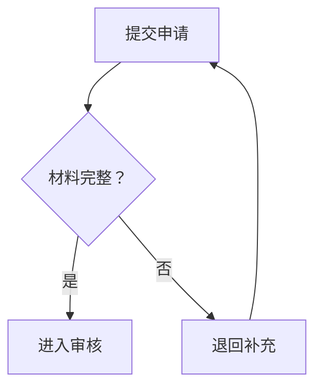

# 图解与表格

用于关系、顺序、层级、状态或比较。一个图围绕一个主要问题，必要时分图，不以固定节点数限制正确表达。

| 内容 | 常用形式 |
|---|---|
| 步骤和分支 | 流程图 |
| 多方调用与消息 | 时序图 |
| 状态变化 | 状态图 |
| 包含与层级 | 树或层级图 |
| 有证据支持的因果关系 | 因果图 |
| 多项属性对比 | 表格 |

## 制作

1. 从已核对的内容依据提取节点、关系、条件和例外。
2. 选读者最容易定位的方向与布局。必要时先展示简图，再补关键分支。
3. 标签简洁，但不为压缩字数改变术语或删掉条件。条件过长可用注释或分图保留。
4. 同类对象采用一致编码；箭头标清调用、数据、顺序或因果含义。没有因果证据的关系不画成确定因果。
5. 不只靠颜色传达类别或失败状态，配合文字、形状或线型。

按环境支持使用 Mermaid、SVG 或 HTML。Mermaid 特殊字符标签需正确引用；中文状态可用别名，例如 `state "已支付" as paid`。代码生成成功不等于渲染成功；如未渲染，说明检查范围。

下面是虚构流程，仅用于演示条件归属：

不能从图中推出审核一定通过，也不能新增原材料没有的自动审批规则。

## 验证

核对每个节点、箭头、条件和异常分支与正文一致。渲染后查看标签、遮挡、连线和阅读顺序。只有读图方式不明显时才加简短说明；不机械附加图例段落。
